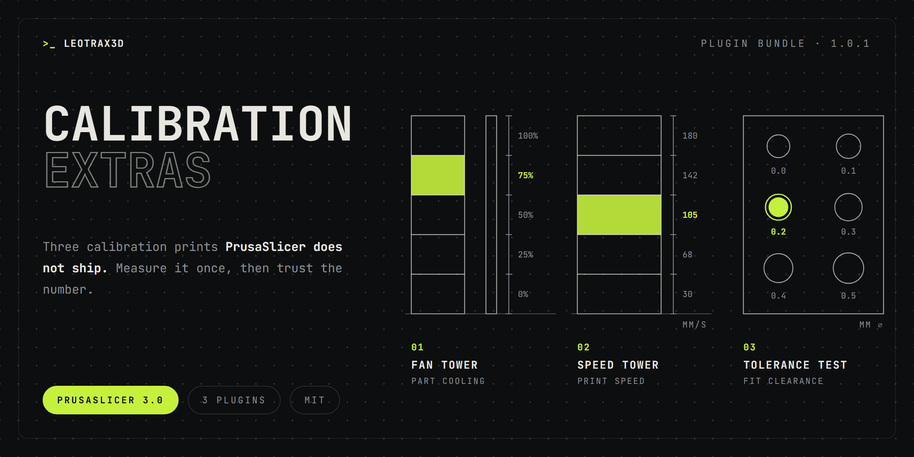

Three calibration prints that PrusaSlicer does not ship, in one install. They complement the built-in Flow Tower and Temperature Tower.

### Included
| Plugin | Menu | What it finds |
| --- | --- | --- |
| **Fan Tower** | Calibration → Fan Tower | The part-cooling fan speed a filament needs |
| **Speed Tower** | Calibration → Speed Tower | The highest print speed without quality loss |
| **Tolerance Test** | Calibration → Tolerance Test | The clearance parts need to fit together |

### Good to know
- Fan Tower and Speed Tower change filament settings in the current project and do not restore them, so run them in a throwaway project. Tolerance Test only sets options on its own objects.
- Each plugin is also available on its own, if you only need one of them.
- Runs fully inside PrusaSlicer's plugin sandbox, with no network access and no files written.

Docs: [Fan Tower](https://github.com/leotrax3d/prusaslicer-plugins-unofficial/blob/main/docs/plugins/fan-tower.md) · [Speed Tower](https://github.com/leotrax3d/prusaslicer-plugins-unofficial/blob/main/docs/plugins/speed-tower.md) · [Tolerance Test](https://github.com/leotrax3d/prusaslicer-plugins-unofficial/blob/main/docs/plugins/tolerance-test.md)
