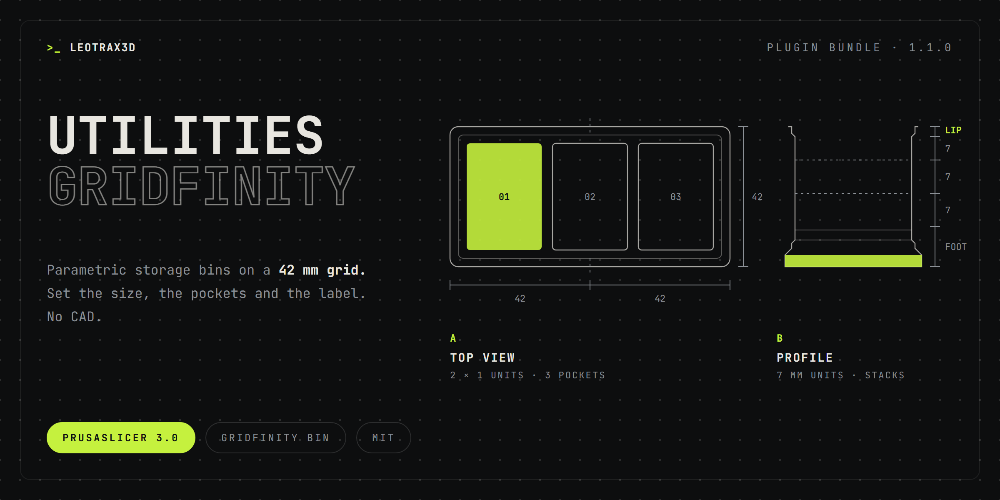

Parametric generators for parts you would otherwise open CAD for.

### Included
| Plugin | Menu | What it makes |
| --- | --- | --- |
| **Gridfinity Bin Generator** | Generators → Gridfinity Bin | Gridfinity-compatible bins with compartments, stacking lip, magnet pockets and a label |

### Good to know
- Version 1.0 replaced the earlier storage box generator with Gridfinity-compatible bins.
- Version 1.1 no longer includes the Ambigram generator.
- The generator keeps its settings on the objects it creates. Your presets stay unchanged.
- An independent implementation of the published Gridfinity dimensions. Not affiliated with Zack Freedman or the Gridfinity community.

Docs: [Gridfinity Bin](https://github.com/leotrax3d/prusaslicer-plugins-unofficial/blob/main/docs/plugins/box-generator.md)
